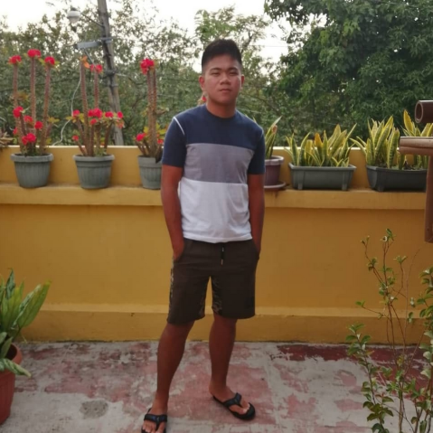

# Daniel Banuelos - Personal Portfolio Website

A modern, responsive personal portfolio website showcasing my projects, skills, and professional experience. Built with pure HTML, CSS, and JavaScript - no frameworks required.



## 🌟 Features

- **Modern Design**: Clean, dark-themed interface with green accent colors
- **Fully Responsive**: Optimized for desktop, tablet, and mobile devices
- **Smooth Animations**: Engaging scroll animations and hover effects
- **Interactive Elements**: 
  - Animated skill icons
  - Project showcase with hover overlays
  - Working contact form integrated with Formspree
- **Performance Optimized**: Lightweight and fast-loading with no external dependencies

## 🚀 Live Demo

Visit the live portfolio: [Your Portfolio URL]

## 📋 Table of Contents

- [Technologies Used](#technologies-used)
- [Project Structure](#project-structure)
- [Features Breakdown](#features-breakdown)
- [Getting Started](#getting-started)
- [Customization](#customization)
- [Contact](#contact)

## 🛠️ Technologies Used

### Frontend
- **HTML5**: Semantic markup for structure
- **CSS3**: Modern styling with animations and responsive design
- **JavaScript (ES6+)**: Interactive functionality and animations

### Tools & Services
- **Formspree**: Contact form backend service
- **Git**: Version control

## 📁 Project Structure

```
new-personal-portfolio/
│
├── index.html          # Main HTML file
├── styles.css          # All styling and animations
├── script.js           # JavaScript functionality
├── README.md           # Project documentation
│
└── images/             # Image assets
    ├── personalpicture.png
    ├── 2dgame.png
    ├── triapora.png
    ├── chessboard.gif
    ├── redditapi.png
    ├── atrui.png
    └── qrgenerator.png
```

## ✨ Features Breakdown

### 1. Hero Section
- Animated introduction with floating shapes
- Smooth scroll indicator
- Call-to-action buttons

### 2. About Section
- Personal introduction
- Professional photo display
- Responsive layout

### 3. Projects Section
- Grid layout showcasing 6 featured projects
- Hover effects with overlay links
- Project tags for technologies used
- Images for each project:
  - 2D Platforming Game (Godot)
  - Triapora Security Agency Business Page
  - Chessboard (Vanilla JS)
  - Reddit API Integration (React.js)
  - Atrui (Gatsby.js, TailwindCSS)
  - QR Code Generator (Vanilla JS)

### 4. Skills Section
- Icon-based skill display
- Organized by categories:
  - **Frontend**: HTML, CSS, JavaScript, React.js, TailwindCSS
  - **Backend**: Node.js, C#, .NET
  - **Tools & Platforms**: Git, VS Code, Figma, WordPress, Divi, Elementor, SEO
- Hover animations on skill icons

### 5. Contact Section
- Contact information with clickable links
- Working contact form integrated with Formspree
- Form validation and success/error messages

### 6. Navigation
- Fixed navigation bar with smooth scrolling
- Mobile-responsive hamburger menu
- Active section highlighting

## 🚀 Getting Started

### Prerequisites
- A modern web browser (Chrome, Firefox, Safari, Edge)
- A text editor (VS Code recommended)
- Basic knowledge of HTML, CSS, and JavaScript

### Installation

1. **Clone the repository**
   ```bash
   git clone https://github.com/ffr00tloops/new-personal-portfolio.git
   cd new-personal-portfolio
   ```

2. **Open the project**
   - Simply open `index.html` in your web browser
   - Or use a local development server:
     ```bash
     # Using Python
     python -m http.server 8000
     
     # Using Node.js (http-server)
     npx http-server
     ```

3. **View the portfolio**
   - Navigate to `http://localhost:8000` (or the port your server uses)

### Setting Up Formspree

1. Create a free account at [Formspree.io](https://formspree.io)
2. Create a new form and get your form endpoint
3. Update the form action in `index.html`:
   ```html
   <form action="https://formspree.io/f/YOUR_FORM_ID" method="POST">
   ```

## 🎨 Customization

### Changing Colors

Edit the CSS variables in `styles.css`:

```css
:root {
    --primary-color: #10b981;      /* Main green color */
    --secondary-color: #059669;      /* Darker green */
    --accent-color: #34d399;         /* Light green */
    /* ... other variables */
}
```

### Adding Projects

1. Add your project image to the `images/` folder
2. Update the project card in `index.html`:
   ```html
   <div class="project-card">
       <div class="project-image">
           
       </div>
       <div class="project-info">
           <h3 class="project-title">Your Project</h3>
           <p class="project-description">Project description</p>
           <div class="project-tags">
               <span class="tag">Technology</span>
           </div>
       </div>
   </div>
   ```

### Updating Skills

Modify the skills section in `index.html` to add or remove skills:

```html
<div class="skill-icon-item">
    <div class="skill-icon-wrapper">
        <span class="skill-icon-emoji">🎨</span>
        <span class="skill-icon-text">Skill Name</span>
    </div>
</div>
```

### Updating Contact Information

Edit the contact section in `index.html` with your details:

```html
<div class="contact-item">
    <div class="contact-icon">📧</div>
    <div>
        <h4>Email</h4>
        <p><a href="mailto:your-email@example.com" class="contact-link">your-email@example.com</a></p>
    </div>
</div>
```

## 📱 Browser Support

- Chrome (latest)
- Firefox (latest)
- Safari (latest)
- Edge (latest)
- Mobile browsers (iOS Safari, Chrome Mobile)

## 🎯 Performance

- No external dependencies
- Optimized images
- CSS animations using transform and opacity for better performance
- Minimal JavaScript for fast loading

## 📝 License

This project is open source and available under the [MIT License](LICENSE).

## 👤 Author

**Daniel Banuelos**

- GitHub: [@ffr00tloops](https://github.com/ffr00tloops)
- LinkedIn: [Daniel Banuelos](https://www.linkedin.com/in/daniel-banuelos-857194222/)
- Email: danielbanuelosdb670@gmail.com

## 🙏 Acknowledgments

- Design inspiration from modern portfolio websites
- Icons and emojis for skill representation
- Formspree for contact form backend

## 📄 Copyright

© 2025 Daniel Banuelos. All rights reserved.

---

**Note**: This portfolio is built with pure HTML, CSS, and JavaScript to demonstrate core web development skills without relying on frameworks or libraries.

